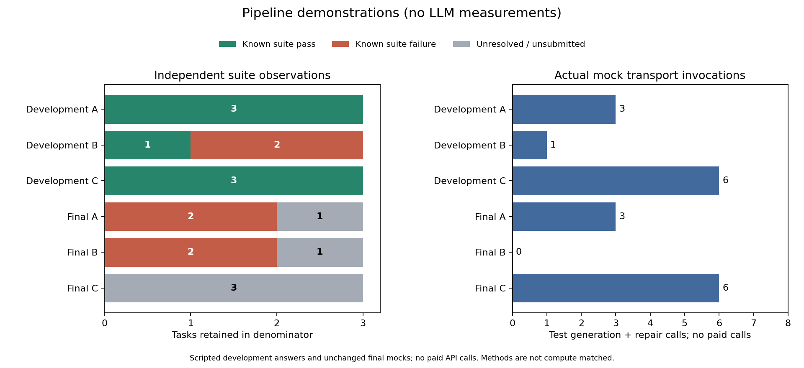

# Pipeline demonstration analysis

**No measured LLM results are available.** Providers are scripted development fixtures or unchanged final-task mocks. These observations validate collection/evaluation/reporting only.

| Split | Method | Tasks | Pass | Fail | Unknown | Mock calls | API USD | Input tokens | Output tokens |
|---|---|---:|---:|---:|---:|---:|---:|---:|---:|
| development | direct | 3 | 3 | 0 | 0 | 3 | 0.0 | unknown | unknown |
| development | feedback | 3 | 1 | 2 | 0 | 1 | 0.0 | unknown | unknown |
| development | augmented | 3 | 3 | 0 | 0 | 6 | 0.0 | unknown | unknown |
| final | direct | 3 | 0 | 2 | 1 | 3 | 0.0 | unknown | unknown |
| final | feedback | 3 | 0 | 2 | 1 | 0 | 0.0 | 0 | 0 |
| final | augmented | 3 | 0 | 0 | 3 | 6 | 0.0 | unknown | unknown |

Input/output tokens remain unknown when not supplied; zero-call runs consumed none. API dollars exclude local compute. All methods retain their actual calls; they are not compute-matched.

Each tasks.csv row records exact repair/score payload hashes, journal hash and completed-event line numbers. summary.csv and analysis.json preserve source protocol identities, incomplete work, execution-status distributions, latency, known subtotals, explicit metric denominators and all selected failure cases. Protocols and byte-checked JSONL evidence remain in the source directories.

Failure cases below retain accepted-but-failing patches, candidate execution errors and terminal repair failures. Repeated-original stopping can leave a candidate unsubmitted. Missing-outcome bounds are not statistical confidence intervals. Suite regression rates require an observed original-suite pass and a known final-suite outcome; see the explicit denominators.

Development and final splits remain separate, as does each protocol; no hosted pilot or measured result is pooled here. Source code, limits, image, prompts/oracles and available seeds are frozen in each protocol. Actual timing depends on this local Docker environment and is not a model-speed comparison.

Reproduce tables with `vericode analyze --run-dir <evidence-directory> ... --output <new-directory>`. Add `--plot` with the optional analysis extra for a standalone Matplotlib SVG. Historical evidence can be analysed under later code; collection resume still rejects changed runtime.

## Failure cases

| Split | Method | Task | Repair stop | Candidate evaluation | Repair / score event |
|---|---|---|---|---|---|
| development | feedback | sum_positive | visible_passed | failed | [L8](../evidence/development/events.jsonl#L8) / [L26](../evidence/development/events.jsonl#L26) |
| development | feedback | count_vowels | visible_passed | failed | [L10](../evidence/development/events.jsonl#L10) / [L28](../evidence/development/events.jsonl#L28) |
| final | direct | quix_gcd | visible_passed | failed | [L2](../evidence/final/events.jsonl#L2) / [L20](../evidence/final/events.jsonl#L20) |
| final | direct | quix_find_first_in_sorted | visible_passed | timeout | [L4](../evidence/final/events.jsonl#L4) / [L22](../evidence/final/events.jsonl#L22) |
| final | direct | quix_is_valid_parenthesization | visible_passed | failed | [L6](../evidence/final/events.jsonl#L6) / [L24](../evidence/final/events.jsonl#L24) |
| final | feedback | quix_gcd | visible_passed | failed | [L8](../evidence/final/events.jsonl#L8) / [L26](../evidence/final/events.jsonl#L26) |
| final | feedback | quix_find_first_in_sorted | visible_passed | timeout | [L10](../evidence/final/events.jsonl#L10) / [L28](../evidence/final/events.jsonl#L28) |
| final | feedback | quix_is_valid_parenthesization | visible_passed | failed | [L12](../evidence/final/events.jsonl#L12) / [L30](../evidence/final/events.jsonl#L30) |
| final | augmented | quix_gcd | repeated_patch | not_submitted | [L14](../evidence/final/events.jsonl#L14) / [L32](../evidence/final/events.jsonl#L32) |
| final | augmented | quix_find_first_in_sorted | repeated_patch | not_submitted | [L16](../evidence/final/events.jsonl#L16) / [L34](../evidence/final/events.jsonl#L34) |
| final | augmented | quix_is_valid_parenthesization | repeated_patch | not_submitted | [L18](../evidence/final/events.jsonl#L18) / [L36](../evidence/final/events.jsonl#L36) |

[Standalone SVG](outcomes-and-calls.svg)
